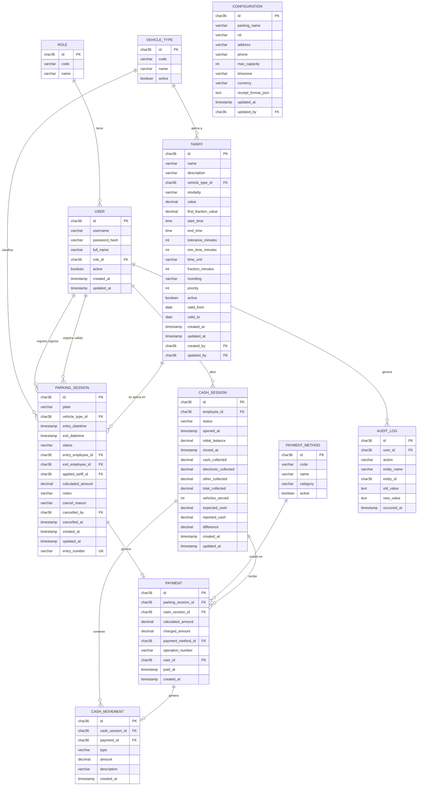

# 07 — Modelo de Datos y ERD

> Fase 2 — SDD. Traduce `03-domain-model.md` a esquema relacional, válido tanto para SQLite (desarrollo) como MySQL (producción futura), sin tipos exclusivos de ningún motor (RNF-015).

## Convenciones de esquema

- **Identificadores:** `CHAR(36)` (UUID v4 en formato texto) en todas las tablas — evita `AUTO_INCREMENT`/`ROWID` propios de un motor (prompt.md §24, RNF-016).
- **Fechas/horas:** `TIMESTAMP` almacenado en UTC; la conversión a la zona horaria configurada (`Configuration.timezone`) ocurre en la capa de aplicación (BR-026), nunca en SQL.
- **Dinero:** `DECIMAL(12,2)` — nunca `FLOAT`/`DOUBLE`, para evitar errores de redondeo en cobros.
- **Enums:** se modelan como `VARCHAR` con `CHECK` constraint (portable entre SQLite y MySQL) en lugar de tipos `ENUM` nativos de MySQL.
- **Soft delete / estados:** ninguna tabla transaccional tiene `DELETE`; los estados (`status`, `active`) cumplen esa función (BR-024).
- **Migraciones:** todo cambio de esquema se aplica vía Flyway (`V1__init.sql`, `V2__...sql`), nunca manualmente (RNF-017).

## ERD

## Índices y restricciones clave

| Tabla | Índice / restricción | Motivo |
|---|---|---|
| `user` | único `(username)` | login por usuario. |
| `role` | único `(code)` | integridad de roles semilla. |
| `vehicle_type` | único `(code)` | integridad de tipos semilla. |
| `parking_session` | índice `(plate)`; único condicional `(plate)` WHERE `status='EN_PARQUEADERO'` | BR-001 — bloquear doble sesión activa. En MySQL: índice único sobre columna generada `plate_active` (`plate` si `status='EN_PARQUEADERO'`, si no `NULL`); en SQLite: índice único parcial nativo (`CREATE UNIQUE INDEX ... WHERE status='EN_PARQUEADERO'`). Documentado en la migración correspondiente, con verificación adicional a nivel de servicio (transacción + reintento) como segunda barrera (RNF-018). |
| `payment` | único `(parking_session_id)`; único `(operation_number)` | BR-021 — idempotencia de cobro. |
| `parking_session` | único `(entry_number)` (`uk_parking_session_entry_number`; admite varios NULL) | BR-027 — consecutivo de ingreso irrepetible. |
| `cash_session` | índice único condicional `(employee_id)` WHERE `status='OPEN'` | BR-022 — una caja abierta por empleado. |
| `tariff` | índice `(vehicle_type_id, active, modality)` | resolución rápida de tarifas aplicables (BR-007/BR-008). |
| `audit_log` | índice `(entity_name, entity_id)`; índice `(occurred_at)` | consultas de auditoría por entidad y por rango de fecha (RF-067). |

## Datos semilla (para Fase 4 / entorno de desarrollo)

- `role`: ADMIN, EMPLOYEE.
- `vehicle_type`: CAR (Automóvil), MOTORCYCLE (Motocicleta).
- `payment_method`: CASH (Efectivo), TRANSFER (Transferencia), OTHER (Otros).
- `configuration`: una fila con valores de ejemplo (`timezone=America/Bogota`, `currency=COP`).
- `user`: un Administrador de prueba y un Empleado de prueba (credenciales de desarrollo únicamente — prompt.md §33; nunca usar en producción).
- `tariff`: tarifas ficticias mínimas para permitir probar el motor (una BY_TIME, una FULL_DAY) por cada tipo de vehículo.

Estos datos semilla se implementarán como migración Flyway específica (`V2__seed_data.sql`) o `data.sql` restringido al perfil `development`, nunca en `production` (Fase 4).

## Evolución del esquema tras la Fase 4

- **`V3__payment_method_category.sql`** (Fase 6): agrega `payment_method.category` (`CASH`/`ELECTRONIC`/`OTHER`) — necesario para que el arqueo de caja (RF-055) calcule el efectivo esperado sin adivinar por `code`. Ver `03-domain-model.md` §PaymentMethod.

- **`V3_1__mysql_foreign_keys_and_datetime.sql`** (Fase 12, **solo MySQL**, `db/vendor/mysql`): las 18 llaves foráneas que MySQL ignoraba en V1 y las fechas como `DATETIME(6)`. Ver `decisions/ADR-006-migracion-mysql.md`.
- **`V4__reference_data.sql`** (2026-09-29): datos de referencia en todos los perfiles (roles, tipos de vehículo, medios de pago, configuración inicial); idempotente. Ver `decisions/ADR-007-arranque-produccion.md`.
- **`V5__operation_counter.sql`** (2026-09-29): tabla `operation_counter (name, counter_value)` para reservar el consecutivo de operación de los pagos (RF-049) de forma atómica. Antes se calculaba como `COUNT(payment) + 1` y, con dos cobros simultáneos en MySQL, ambos obtenían el mismo número y uno fallaba con 500. Arranca en `COUNT(*)` de los pagos existentes, que coincide con el último número emitido porque los pagos nunca se borran (BR-024).
- **`V7__subscriptions.sql`** (2026-10-19): tablas `subscription`, `subscription_vehicle` (único `plate`) y `subscription_payment` (único `operation_number`), con FK como restricciones de tabla y fechas `DATETIME(6)` (misma afinidad que `TIMESTAMP` en SQLite); columnas `parking_session.subscription_id` y `configuration.subscription_grace_days` (por defecto 3). `V7_1__mysql_subscription_foreign_key.sql` (solo MySQL) crea la FK de `parking_session.subscription_id`, que MySQL descarta en línea (como V3_1). Las fechas sin hora (`paid_until`, `period_from/to`) se mapean como texto `yyyy-MM-dd`, igual que las de `tariff` (ADR-005).
- **`V6__parking_session_entry_number.sql`** (2026-10-05): columna `parking_session.entry_number VARCHAR(20)` con índice único y fila `ENTRY` en `operation_counter` (arranca en 0) para el comprobante de ingreso (RF-072, BR-027). Portable SQLite/MySQL. Las sesiones previas quedan con `entry_number` NULL.

## Estrategia SQLite → MySQL

Ver detalle de mecanismo en `06-architecture.md` §"Estrategia SQLite → MySQL" y el procedimiento verificado en `decisions/ADR-006-migracion-mysql.md`. Resumen: mismo esquema lógico, migraciones Flyway comunes portables más migraciones exclusivas por motor en `db/vendor/{motor}`, cambio de motor limitado a `spring.datasource.*` y el dialecto JPA por perfil, sin tocar entidades ni repositorios. **Toda migración común nueva debe probarse en ambos motores** (`mvn test` y `scripts/verify-mysql.sh`): la V5 pasó en SQLite y falló en MySQL porque `last_value` es palabra reservada allí.
