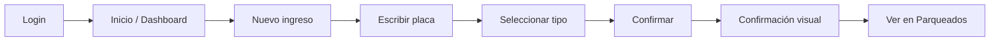
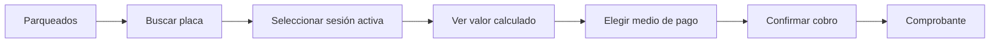
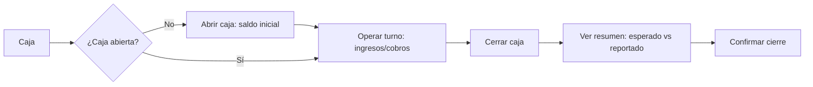
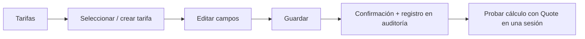
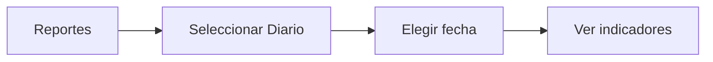

# 09 — Especificación UX/UI

> Fase 3 — SDD. Cubre mapa de navegación, user flows, wireframes, design system (sobre Tailwind CSS, `decisions/ADR-001`) y componentes reutilizables para las 11 pantallas mínimas de `prompt.md` §38 (Fase 3). Objetivo rector: **velocidad + claridad + mínimo número de acciones** (`prompt.md` §20), protegiendo especialmente el flujo INGRESO → BÚSQUEDA → SALIDA → COBRO (RNF-001 a RNF-004).

---

## 1. Mapa de navegación

### Desktop / tablet ancho (≥768px) — barra lateral persistente

```
Empleado                          Administrador
┌────────────┐                    ┌────────────┐
│ Inicio      │                    │ Dashboard    │
│ Nuevo ingreso│                    │ Parqueados   │
│ Parqueados  │                    │ Historial    │
│ Cobros      │                    │ Reportes     │
│ Caja        │                    │ Tarifas      │
└────────────┘                    │ Usuarios     │
                                    │ Caja         │
                                    │ Configuración│
                                    │ Auditoría    │
                                    └────────────┘
```

### Mobile (<768px) — barra inferior + panel "Más"

Siguiendo `prompt.md` §21, la barra inferior prioriza las funciones más usadas. El Administrador tiene más secciones de las que caben en una barra inferior (regla de UX: máximo 5 ítems visibles) — **decisión de diseño**: se muestran las 4 más operativas y el resto queda en un panel "Más" (drawer), sin perder ningún acceso.

```
Empleado (barra inferior — 5 ítems, todos visibles):
[ Inicio ] [ Ingreso ] [ Parqueados ] [ Cobros ] [ Caja ]

Administrador (barra inferior — 4 ítems + Más):
[ Dashboard ] [ Parqueados ] [ Caja ] [ Reportes ] [ Más ▾ ]
                                                       │
                                    ┌──────────────────▼───────────────────┐
                                    │ Historial · Tarifas · Usuarios ·      │
                                    │ Configuración · Auditoría              │
                                    └────────────────────────────────────────┘
```

Ítem activo resaltado con color primario + label corto; iconografía simple y reconocible (placa/coche para "Parqueados", billete para "Cobros/Caja", gráfico para "Reportes"). Objetivo táctil mínimo por ítem: 44×44px (RNF-004).

---

## 2. User flows prioritarios (referencian los casos de uso de `04-use-cases.md`)

### Flujo 1 — Login → registrar ingreso → verificar activo (UC-001, UC-002, UC-003)



### Flujo 2 — Buscar placa → calcular tarifa → pagar → salida (UC-004, UC-005)



### Flujo 3 — Abrir caja → operaciones → cerrar caja (UC-006, UC-007)



### Flujo 4 — Administrador modifica tarifa → verifica (UC-008)



### Flujo 5 — Generar reporte diario (UC-010)



---

## 3. Design system sobre Tailwind CSS

### 3.1 Principio

Tailwind es utility-first; para mantener consistencia (`prompt.md` §18, ADR-001) se define una capa de **tokens** (config de Tailwind) y una capa de **componentes** (`@layer components`) reutilizados en toda la app — nunca se combinan utilidades ad-hoc distintas para el mismo propósito (ej. dos tonos de azul para "primario").

### 3.2 Tokens (`tailwind.config`)

| Token | Valores | Uso |
|---|---|---|
| `color.primary` | escala 50-900 (azul) | Acciones principales, navegación activa. |
| `color.success` | escala 50-900 (verde) | Confirmaciones, cobro exitoso, sesión `EN_PARQUEADERO`. |
| `color.danger` | escala 50-900 (rojo) | Anulaciones, errores, diferencias de caja negativas. |
| `color.warning` | escala 50-900 (ámbar) | Alertas no bloqueantes (capacidad casi llena). |
| `color.neutral` | escala 50-900 (gris) | Texto, bordes, fondos. |
| `fontSize` | `xs`…`3xl`, con `text-plate` custom (28-36px, bold, monoespaciada) | La placa es el elemento visual principal (`prompt.md` §7) — necesita su propio token tipográfico. |
| `spacing` | escala Tailwind estándar (4px base) | — |
| `borderRadius` | `md` (8px) por defecto en cards/inputs/botones | Consistencia visual. |
| `minHeight.touch` | `44px` | Toda superficie interactiva (RNF-004). |

### 3.3 Paleta semántica de estados de sesión

| Estado | Color | Uso |
|---|---|---|
| `EN_PARQUEADERO` | `success` (verde) | Badge en listas, indica vehículo activo. |
| `FINALIZADO` | `neutral` (gris) | Historial. |
| `ANULADO` | `danger` (rojo) | Historial, con ícono de alerta. |

### 3.4 Identidad visual (rediseño previo a la Fase 12)

Definida con la skill *ui-ux-pro-max* (estilo "Minimalism + Flat" recomendado para operación/logística, con tarjetas de indicadores tipo *data-dense dashboard* en administración) y validada contra las reglas de *dataviz*. Tokens en `frontend/src/index.css`.

| Aspecto | Decisión | Motivo |
|---|---|---|
| Tema | Claro, fondo `neutral-50` (slate), tarjetas blancas; barra lateral `neutral-900` | Contraste AA en uso diurno; se descartó el tema oscuro sugerido inicialmente por la skill. |
| Color primario | `primary-600` = `#2563EB` (blue-600) | Mantiene el token de §3.2. Neutros pasan de gray a slate. |
| Tipografía | Fira Sans (texto) + Fira Code (placas, cifras de operación) — empaquetadas localmente y precacheadas por el service worker | Pareja "Dashboard Data" de la skill; §3.2 ya pedía placa monoespaciada; sin CDN para no romper el shell offline. |
| Placa (`PlateBadge`) | Estilo placa colombiana: fondo `plate-yellow`, borde y texto negros | La placa es el elemento visual principal (`prompt.md` §7). |
| Iconografía | SVG de Lucide (`lucide-react`), nunca emojis | Regla *no-emoji-icons*. |
| Movimiento | 150–300 ms; se respeta `prefers-reduced-motion` | Reglas *duration-timing* / *reduced-motion*. |
| Gráficos (reportes, ocupación) | Barras de una sola serie en un solo color; medidor con pista del mismo tono que el relleno; cifras grandes con números proporcionales | Reglas de *dataviz*. |

Componentes de §4 implementados en `frontend/src/components/`: `Button` (con `loading`), `PlateBadge`, `StatusBadge`, `StatCard`, `EmptyState`, `Toast`, `ConfirmDialog` (`<dialog>` nativo: foco atrapado, Esc) y campos de formulario con label asociado. `ConfirmDialog` se usa en cobro y cierre de caja (§6).

---

## 4. Componentes reutilizables

| Componente | Descripción | Usado en |
|---|---|---|
| `Button` (`primary`/`secondary`/`danger`, tamaño `lg` por defecto) | Botón táctil grande (`min-h-touch`), estado `loading` que se autodeshabilita para evitar doble envío (RNF-019, BR-021). | Todas las pantallas. |
| `PlateInput` | Input de placa: mayúsculas automáticas al escribir, sin espacios, feedback de normalización en vivo (BR-002). | Nuevo ingreso, búsqueda. |
| `PlateBadge` | Muestra la placa como elemento tipográfico principal (`text-plate`), con tipo de vehículo como icono secundario. | Parqueados, Cobro/salida, Historial. |
| `StatusBadge` | Pastilla de color según estado de sesión (§3.3). | Parqueados, Historial. |
| `ResponsiveList` | Tabla en desktop (`≥768px`), lista de tarjetas apiladas en mobile — nunca tabla con scroll horizontal en mobile (`prompt.md` §20). | Parqueados, Historial, Usuarios, Tarifas, Auditoría. |
| `StatCard` | Tarjeta con número grande + etiqueta, usada en Dashboard/Caja. | Dashboard, Cierre de caja. |
| `ConfirmDialog` | Modal de confirmación para operaciones críticas (cobro, anulación, cierre de caja) — texto claro de la consecuencia, sin jerga técnica (`prompt.md` §20). | Cobro/salida, Anulación, Cierre de caja. |
| `Toast` | Confirmación visual breve no bloqueante (ingreso registrado, tarifa guardada). | Transversal. |
| `EmptyState` | Mensaje + icono cuando una lista está vacía (ej. "No hay vehículos parqueados"). | Parqueados, Historial. |
| `BottomNavBar` / `Sidebar` | Navegación (§1), responsive por breakpoint. | Shell de la app. |

---

## 5. Wireframes (mobile-first; layout desktop se indica como nota de adaptación)

### 5.1 Login

```
┌──────────────────────────┐
│        [Logo/Nombre]      │
│                            │
│  Usuario                  │
│  [______________________] │
│  Contraseña                │
│  [______________________] │
│                            │
│  [   Iniciar sesión   ]   │ ← Button primary, full width
│                            │
└──────────────────────────┘
```
Desktop: mismo formulario centrado en tarjeta de 400px sobre fondo neutro.

### 5.2 Dashboard (Administrador)

```
┌──────────────────────────┐
│ Ocupados: 12 / 40 (30%)   │ ← StatCard destacado
│ ▓▓▓▓▓▓░░░░░░░░░░░░░░░░░  │
├──────────────────────────┤
│ Ingresos hoy: 28          │
│ Salidas hoy: 16           │  ← StatCard grid 2 col (mobile) / 4 col (desktop)
│ Recaudo hoy: $340.000     │
│ Estado de caja: Abierta   │
├──────────────────────────┤
│ Últimos movimientos        │
│ • ABC123 salió — $5.000    │
│ • XYZ987 ingresó            │
└──────────────────────────┘
```

### 5.3 Nuevo ingreso

```
┌──────────────────────────┐
│  Nuevo ingreso             │
│                            │
│  Placa                    │
│  [ A B C 1 2 3 ]           │ ← PlateInput grande, autofocus
│                            │
│  Tipo de vehículo           │
│  [ 🚗 Auto ] [ 🏍 Moto ]   │ ← selector grande de 2 botones, no dropdown
│                            │
│  Observaciones (opcional)   │
│  [______________________] │
│                            │
│  [    Confirmar ingreso   ]│
└──────────────────────────┘
```
Tras confirmar: `Toast` de éxito + regreso automático a esta misma pantalla lista para el siguiente ingreso (minimiza pasos para el flujo repetitivo, RNF-001). Si la configuración tiene activado *Imprimir comprobante al registrar el ingreso* (RF-015/RF-072), bajo el formulario queda un aviso con la placa, el número `ING-…` y el botón **Imprimir comprobante**, que abre `/comprobantes-ingreso/{id}` (vista imprimible con Volver/Imprimir); el aviso se reemplaza con el siguiente ingreso. Igualmente, en Cobro/salida el botón *Ver comprobante para imprimir* solo aparece si *Imprimir comprobante al registrar la salida* está activado.

### 5.4 Vehículos parqueados

```
┌──────────────────────────┐
│  🔍 Buscar placa...        │
├──────────────────────────┤
│  [ABC123] 🚗  EN_PARQ.     │
│  Ingresó: 10:05 · 1h 20m   │
│  Empleado: Juan             │        ← ResponsiveList (card en mobile)
│  [    Registrar salida   ] │
├──────────────────────────┤
│  [XYZ987] 🏍  EN_PARQ.     │
│  Ingresó: 11:40 · 15m       │
│  [    Registrar salida   ] │
└──────────────────────────┘
```
Desktop: tabla con columnas Placa | Tipo | Ingreso | Tiempo | Empleado | Acción.

### 5.5 Cobro / salida

```
┌──────────────────────────┐
│  [ABC123] 🚗                │  ← PlateBadge
│  Ingreso: 10:05 · Salida: ahora│
│  Permanencia: 1h 35m         │
│  Tarifa: Por tiempo - Auto    │
│                              │
│  Valor a cobrar               │
│  $ 5.000                     │  ← texto grande, alto contraste
│                              │
│  Medio de pago                │
│  [Efectivo] [Transferencia] [Otros] │
│                              │
│  [     Confirmar cobro     ] │ ← abre ConfirmDialog
└──────────────────────────┘
```

### 5.6 Caja (apertura / durante turno / cierre)

```
Apertura:                         Cierre:
┌───────────────────┐            ┌───────────────────┐
│ Abrir caja          │            │ Cerrar caja          │
│ Saldo inicial        │            │ Saldo inicial: $50.000│
│ [__________]         │            │ Efectivo: $200.000     │
│ [  Abrir caja  ]     │            │ Electrónico: $80.000   │
└───────────────────┘            │ Total: $280.000        │
                                    │ Vehículos: 34            │
                                    │ Efectivo esperado: $250.000│
                                    │ Efectivo reportado          │
                                    │ [__________]                │
                                    │ Diferencia: (calculada)      │
                                    │ [   Confirmar cierre   ]     │
                                    └───────────────────┘
```

### 5.7 Historial

```
┌──────────────────────────┐
│  Filtros: fecha · placa ·  │
│  estado · empleado ▾        │
├──────────────────────────┤
│  [ABC123] FINALIZADO       │
│  10:05 → 11:40 · $5.000    │
├──────────────────────────┤
│  [XYZ987] ANULADO           │
│  motivo: error de digitación │
└──────────────────────────┘
```

### 5.8 Reportes

```
┌──────────────────────────┐
│ [Diario][Semanal][Mensual][Rango]│ ← tabs
│ Fecha: [____] (o rango)     │
├──────────────────────────┤
│ Vehículos ingresados: 45     │
│ Vehículos finalizados: 40    │
│ Autos / Motos: 30 / 15         │
│ Total recaudado: $520.000     │
│ Por medio de pago: ...         │
│ Duración promedio: 1h 12m      │
│ Hora pico: 8:00-9:00           │
└──────────────────────────┘
```

### 5.9 Tarifas

```
┌──────────────────────────┐
│  [ + Nueva tarifa ]        │
├──────────────────────────┤
│  Por tiempo - Auto  ✅ activa│
│  $1.000/30min · prioridad 2 │
│  [Editar] [Desactivar]      │
├──────────────────────────┤
│  Todo el día - Moto  ✅     │
│  $8.000 · prioridad 1        │
└──────────────────────────┘
```
Formulario de tarifa (crear/editar) en pantalla completa o panel lateral en desktop, con los campos de `03-domain-model.md` agrupados por relevancia (identificación → condición horaria → cálculo → vigencia/prioridad).

### 5.10 Usuarios

```
┌──────────────────────────┐
│  [ + Nuevo usuario ]        │
├──────────────────────────┤
│  Juan Pérez · Empleado ✅   │
│  [Editar] [Desactivar]      │
├──────────────────────────┤
│  María Gómez · Admin ✅     │
└──────────────────────────┘
```

### 5.11 Configuración

```
┌──────────────────────────┐
│  Datos del parqueadero      │
│  Nombre [__________]        │
│  NIT [__________]           │
│  Dirección [__________]      │
│  Capacidad máx. [____]       │
│  Zona horaria [America/Bogota]│
│  Moneda [COP]                  │
│  Medios de pago: Efectivo,     │
│  Transferencia, Otros [Editar] │
│  [      Guardar cambios      ] │
└──────────────────────────┘
```

### 5.12 Respaldo (RF-073)

Dos tarjetas (lado a lado en desktop, apiladas en móvil):
- **Exportar respaldo**: advertencia de datos sensibles (ámbar) y botón *Descargar respaldo*.
- **Importar respaldo**: advertencia (roja) de que se borran todos los datos, selector de archivo `.json`, resumen leído en el navegador (fecha, motor de origen, versión de esquema, conteos por tabla) y botón *Importar y reemplazar* (`danger`). La confirmación (`ConfirmDialog`) exige escribir **REEMPLAZAR**; al terminar se cierra la sesión y se va al login.

> Auditoría (pantalla adicional de administrador, no listada entre las 11 mínimas pero requerida por `prompt.md` §15): misma estructura de `ResponsiveList` que Historial, con columnas Usuario/Acción/Entidad/Fecha y detalle expandible de valor anterior/nuevo.

---

## 6. Diseño responsive

| Breakpoint | Layout |
|---|---|
| `<768px` (móvil) | Una columna, `BottomNavBar`, listas como tarjetas, formularios apilados. |
| `768–1024px` (tablet) | `Sidebar` colapsable o `BottomNavBar` según orientación; grids de 2 columnas en Dashboard. |
| `≥1024px` (desktop) | `Sidebar` persistente, `ResponsiveList` como tabla, Dashboard en grid de 4 columnas. |

Reglas transversales (`prompt.md` §20):
- Ningún elemento interactivo por debajo de 44×44px.
- Contraste mínimo AA (4.5:1) en texto sobre fondo, verificado con la paleta de §3.2.
- Formularios cortos: máximo los campos estrictamente necesarios visibles de entrada; campos opcionales colapsados/expandibles cuando aplique (ej. observaciones en ingreso).
- Confirmación explícita (`ConfirmDialog`) solo en operaciones irreversibles o financieras (cobro, cierre de caja, anulación) — nunca en navegación simple, para no añadir fricción al flujo crítico.

---

## 7. Trazabilidad con requisitos

Este documento satisface RNF-001 a RNF-004 (velocidad/usabilidad), RNF-006 (responsive) y sirve de base de diseño para las pantallas referenciadas en `12-traceability-matrix.md` bajo cada feature planeada. Se actualizará `12-traceability-matrix.md` con la columna "Pantallas relacionadas" cuando cada feature se formalice en `/specs/features/*.md` (Fase 5 en adelante).
